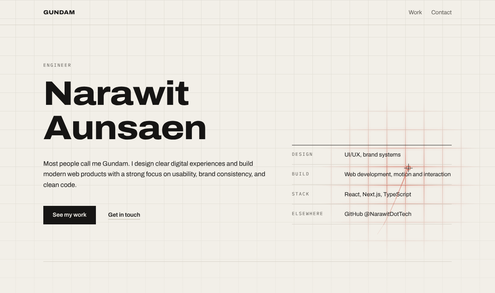
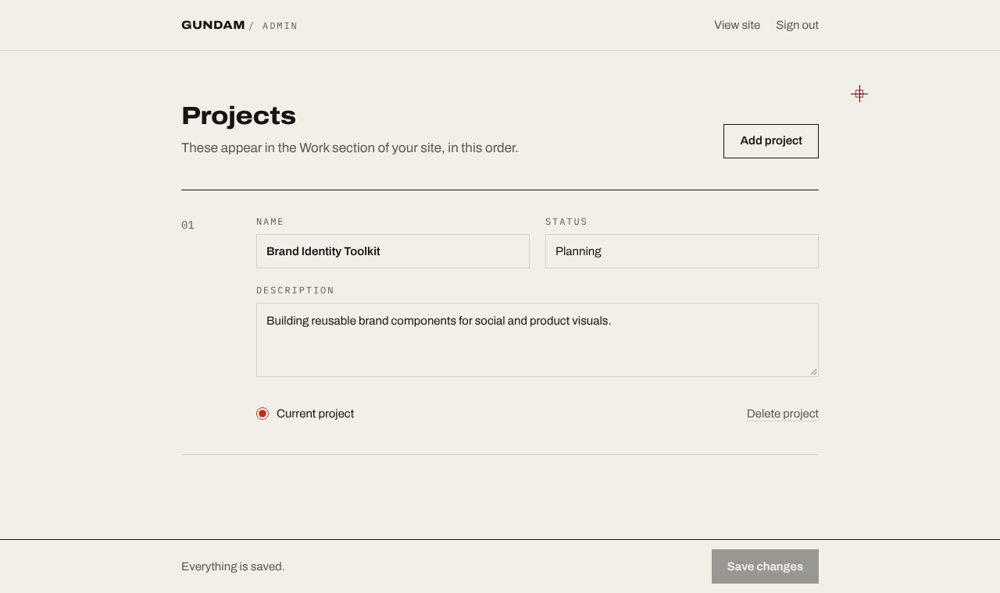

<div align="center">

<picture>
  <source media="(prefers-color-scheme: dark)" srcset="docs/hero-dark.png">
  
</picture>

# `GUNDAM` / intro site

**The personal site of Narawit “Gundam” Aunsaen, engineer.**
<br>
Designed like a technical spec sheet. Built with Next.js. Runs on Cloudflare Workers.

<br>


</div>

<br>

```
┌───────────────────────────────────────────────────────────────────────────┐
│  SPEC  ·  SHEET 01 OF 01                                   REV  2026.11   │
├───────────────┬───────────────────────────────────────────────────────────┤
│  SUBJECT      │  Personal site + project editor                           │
│  PAPER        │  #F2EFE8  ░  warm off-white       (dark: #131312)         │
│  INK          │  #161514  █  near-black           (dark: #ECE9E2)         │
│  SIGNAL       │  #C22D18  ▓  one red, used sparingly                      │
│  TYPE         │  Archivo (expanded) + IBM Plex Mono                       │
│  CORNERS      │  0px. Everywhere.                                         │
└───────────────┴───────────────────────────────────────────────────────────┘
```

## What’s inside

| | Feature | Detail |
|:-:|---|---|
| ⌖ | **Drafting cursor** | A thin crosshair replaces the pointer and leaves a red trail that fades out in under half a second. Over links and buttons it rotates and opens into a diamond. Text fields keep the normal I-beam. |
| ▦ | **Glowing grid** | A faint 48px grid sits behind the top of the page and fades out as you scroll. Near the mouse the lines glow red, easing after the cursor. |
| ↑ | **Load + scroll motion** | Your name rises in letter by letter, table rules draw across, and rows stagger in as they scroll into view. The current project’s status light blinks. |
| ◐ | **Light and dark** | Follows the visitor’s system theme. Every color is a token that switches as a set. |
| ♿ | **Motion that asks first** | Visitors with *reduce motion* on get a static page, plus a small prompt offering to turn animations on for this site. Their choice is remembered. |
| ✎ | **Project editor** | `/admin` edits the Work section: name, status, description, which one is current. Passcode checked on the server. |

<br>

<div align="center">

<sub><code>/admin</code>: projects as ruled rows, with a save bar that always says whether you’re saved.</sub>
</div>

## Run it

```bash
npm install
```

```bash
echo "ADMIN_PASSCODE=choose-a-passcode" > .env.local
```

```bash
npm run dev
```

The site runs at **http://localhost:3000** and the editor at **http://localhost:3000/admin**.
Locally, projects are saved to `data/projects.json`.

| Command | Does |
|---|---|
| `npm run dev` | Dev server with hot reload |
| `npm run build` | Production build |
| `npm run start` | Serve the production build |
| `npm run lint` | ESLint |

## Deploy to Cloudflare

The site deploys to the Cloudflare Worker **`gundam-intro-site-main`** on every push to `master`.
The editor needs two one-time settings on that Worker:

1. **Passcode.** Workers → `gundam-intro-site-main` → Settings → Variables and Secrets →
   add a **Secret** named `ADMIN_PASSCODE`.
2. **Storage.** Storage & Databases → KV → create a namespace (e.g. `gundam-projects`), then
   Workers → `gundam-intro-site-main` → Settings → Bindings → add a **KV namespace** binding
   with the variable name `PROJECTS`.

Without the binding the site still shows the projects from `data/projects.json`;
saving in the editor explains what’s missing instead of failing silently.

## Map

```
src/
├── app/
│   ├── page.tsx                  the one-page site: hero, work, contact
│   ├── admin/page.tsx            passcode sign-in + project editor
│   ├── api/projects/route.ts     GET projects · PUT to save (passcode required)
│   ├── api/admin/session/        POST to check the passcode
│   ├── layout.tsx                fonts, metadata, motion-preference script
│   └── globals.css               color tokens, cursor, grid, motion
├── components/
│   ├── cursor-trail.tsx          crosshair + canvas trail
│   ├── grid-background.tsx       top-of-page grid with hover glow
│   ├── scroll-reveal.tsx         marks [data-animate] elements as they enter
│   ├── motion-prompt.tsx         “turn animations on?” for reduced-motion visitors
│   ├── projects-section.tsx      the Work list
│   └── admin/project-editor.tsx  one editable project row
└── lib/
    ├── site.ts                   your intro text, links, focus areas
    ├── projects.ts               project type + client API helpers
    └── server/                   KV / file storage and passcode check
```

**Editing your details:** intro text, social links and the table beside your name all live in
[`src/lib/site.ts`](src/lib/site.ts). The design rules live in [`DESIGN.md`](DESIGN.md).

<br>

<div align="center">
<sub>

`NARAWIT AUNSAEN` &nbsp;·&nbsp; [GitHub](https://github.com/NarawitDotTech) &nbsp;·&nbsp; [Instagram](https://www.instagram.com/gundamshrkdv) &nbsp;·&nbsp; [Facebook](https://www.facebook.com/narawit.aunsaen.5)

</sub>
</div>
